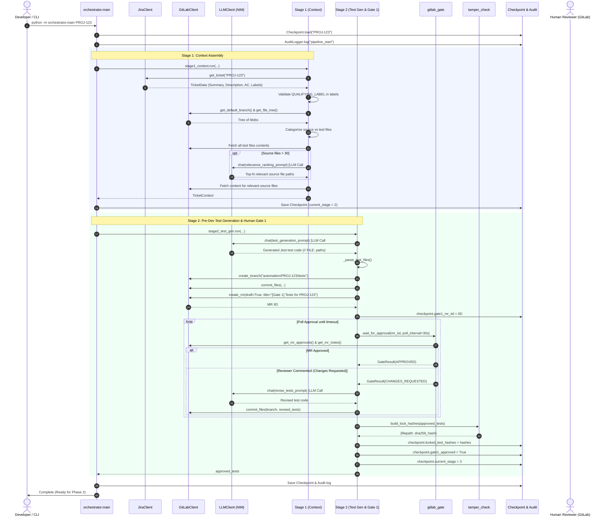

# Phase 1 Implementation Guide: Serialized Flow & Architecture

This document provides an exhaustive, serialized breakdown of **Phase 1 (Proof of Concept)** of the Spec-Driven Development Automation pipeline. It traces the end-to-end execution lifecycle—from initial CLI trigger, through API interactions and Large Language Model (LLM) calls, to GitLab Merge Request creation, Gate 1 human approval, and test locking—followed by an in-depth explanation of every file in the codebase.

---

## 1. High-Level Architecture Overview

Phase 1 establishes the automated foundation for spec-driven development:
- **Input**: A JIRA ticket key carrying the qualifying label (`SpecDrivenDev`).
- **Processing**: Extracts ticket specifications, inspects the target GitLab repository (JavaScript/TypeScript/React/Redux), prompts NVIDIA NIM (GLM-5.3 / DeepSeek V4 Pro) to generate unit/integration Jest tests matching acceptance criteria *before any implementation code is written*, opens a GitLab Merge Request for tests, and polls for human review (Gate 1).
- **Output**: An approved, locked test suite with SHA-256 integrity digests stored in a persistent checkpoint, establishing the immovable test specification for Phase 2 code generation.



---

## 2. Serialized End-to-End Flow (Step-by-Step)

The pipeline executes strictly sequentially. Below is the exact trace of execution from command invocation to completion:

### Step 0: Invocation & Environment Bootstrapping
1. **Trigger**: The operator or script executes:
   ```bash
   python -m orchestrator.main <TICKET_ID> [--verbose] [--dry-run]
   ```
2. **Configuration Loading** (`orchestrator/config.py`):
   - `get_settings()` lazily instantiates the Pydantic `Settings` model.
   - Loads environment variables from `.env` or system env (JIRA URL/token, GitLab URL/token/repo, NVIDIA NIM base URL/API key/models, rate limits, gate timeouts).
   - Validates all required connection URLs, tokens, and model identifiers.
3. **Logging Setup**: `_setup_logging()` configures standard logging format with timestamps, module names, and severity levels.
4. **Dry-Run Check**: If `--dry-run` was supplied, the script validates that configuration loaded properly and exits immediately with status code `0`.

### Step 1: Subsystem & Client Initialization
`orchestrator/main.py` instantiates all shared services:
- **`RateLimiter`**: Sliding-window limiter tracking timestamps to enforce `RATE_LIMIT_CAP` (default 50 calls/min) across all LLM requests.
- **`JiraClient`**: Wraps the JIRA REST API (`atlassian-python-api` / custom REST) using `JIRA_BASE_URL`, `JIRA_USER_EMAIL`, and `JIRA_API_TOKEN`.
- **`GitLabClient`**: Connects via `python-gitlab` to `GITLAB_BASE_URL` with `GITLAB_API_TOKEN` scoped to project `GITLAB_REPO_ID`.
- **`LLMClient`**: Wraps OpenAI client pointed to NVIDIA NIM (`NIM_BASE_URL`), configuring primary model (`NIM_MODEL` = GLM-5.3) and fallback model (`NIM_FALLBACK_MODEL` = DeepSeek V4 Pro), injecting the system prompt and the `RateLimiter` instance.
- **`AuditLogger`**: Initializes append-only audit stream at `<AUDIT_DIR>/<TICKET_ID>.jsonl`.

### Step 2: Checkpoint Inspection & State Recovery
1. `Checkpoint.load(ticket_id, settings.checkpoint_dir)` searches for `<CHECKPOINT_DIR>/<TICKET_ID>.json`.
2. **If found (Resume Mode)**:
   - Loads previously executed stage, iteration count, locked hashes, MR IIDs, and previous conversation history.
   - Re-populates `llm.set_history(checkpoint.conversation_history)` so context is not lost across process crashes.
3. **If not found (Fresh Run)**:
   - Instantiates a fresh `Checkpoint(ticket_id=ticket_id)`.
4. `AuditLogger.log()` emits a `pipeline_start` event with resumption metadata.

---

### Step 3: Stage 1 — Assemble Ticket Context (`stage1_context.py`)

*Goal: Assemble all relevant context (JIRA spec + repository code + test landscape) into a unified `TicketContext`.*

1. **JIRA Fetch & Qualification Verification**:
   - Calls `jira.get_ticket(ticket_id)`.
   - Extracts `summary`, `description`, `acceptance_criteria` (parsed from description or custom fields), and `labels`.
   - **Gate Check**: Asserts `QUALIFYING_LABEL` (`SpecDrivenDev`) exists in `ticket.labels`. If absent, raises `ValueError`, aborting pipeline execution to prevent unauthorized processing.
2. **Repository File Tree Enumeration**:
   - Retrieves default branch name from GitLab (`gitlab.get_default_branch()`, e.g., `main` or `master`).
   - Recursively fetches repository tree blobs: `gitlab.get_file_tree(ref=default_branch, recursive=True)`.
   - Filters out non-code directories (`node_modules`, `dist`, `build`, `.git`, `coverage`, `__pycache__`).
3. **File Categorization**:
   - Classifies file paths into test files (matching `*.test.ts`, `*.spec.tsx`, etc.) and source files (`*.ts`, `*.tsx`, `*.js`, `*.jsx`).
4. **Test Context Ingestion**:
   - Fetches full content of all existing test files via `gitlab.get_file_content()` to teach the LLM repo-specific testing patterns, assertions, and mock structures.
5. **Relevance Ranking (**`LLM Call #1`**)**:
   - If repository source files exceed 30:
     - Prompts LLM with the JIRA summary, description, acceptance criteria, and full file path list.
     - The LLM identifies the top 30 files most relevant to the ticket.
   - If 30 or fewer source files exist, all source files are selected.
   - Source file contents are fetched from GitLab.
6. **Context Materialization & Stage 1 Checkpoint**:
   - Packages data into `TicketContext` dataclass.
   - Updates `checkpoint.current_stage = 2`.
   - Serializes conversation history into `checkpoint.conversation_history`.
   - Persists checkpoint to disk and writes `stage1_complete` to audit log.

---

### Step 4: Stage 2 — Test Generation & Gate 1 Approval (`stage2_test_gen.py`)

*Goal: Generate comprehensive tests strictly from specifications, seek human review via GitLab MR, and lock tests upon approval.*

1. **Test Generation (**`LLM Call #2`**)**:
   - Builds prompt containing:
     - JIRA ticket ID, summary, description, and acceptance criteria.
     - Relevant source file signatures and contents.
     - Existing test conventions in the repository.
     - Strict instructions: Generate tests driven **solely by acceptance criteria** (unit, integration, edge-case). Output must use `// FILE: path/to/file.test.ts` followed by fenced code blocks.
   - Invokes `llm.chat(prompt)`.
   - `_parse_test_files()` extracts generated test file paths and contents.
2. **Git Branch & Commit**:
   - Branch name: `automation/<TICKET_ID>/tests`.
   - Verifies if branch exists; if not, creates branch from `default_branch`.
   - Commits generated test files via GitLab Commit API with message: `[spec-driven] Generate tests for <TICKET_ID>`.
3. **GitLab MR Creation**:
   - Opens draft MR from `automation/<TICKET_ID>/tests` into `default_branch`.
   - Title: `[Gate 1] Tests for <TICKET_ID>: <SUMMARY>`.
   - Description includes the full acceptance criteria, list of generated test files, and review instructions.
   - Saves `mr_info.iid` to `checkpoint.gate1_mr_iid`.
   - Emits `gate1_opened` audit log.
4. **Gate 1 Approval Polling Loop (`gitlab_gate.py`)**:
   - Enters `wait_for_approval(mr_iid, poll_interval=30s, timeout_hours=48.0)`.
   - At each poll interval:
     - Queries GitLab Approvals API (`GET /projects/:id/merge_requests/:iid/approvals`).
     - Queries Merge Request Notes API (`GET /projects/:id/merge_requests/:iid/notes`) for comments.
   - **Branch A: Approved**:
     - When `approvals.approved` is `True`, returns `GateResult(outcome=APPROVED)`.
     - Logs `gate1_approved` audit record.
   - **Branch B: Changes Requested / Feedback (**`LLM Call #3 - Conditional`**)**:
     - If non-system reviewer comments appear while unapproved, triggers `_revise_tests()`.
     - Prompts LLM with the reviewer's feedback, previous test code, and acceptance criteria.
     - Commits updated tests to the same branch (`[spec-driven] Revise tests for <TICKET_ID> (revision N)`).
     - Loops back to polling (up to 5 revision cycles).
   - **Branch C: Timeout**:
     - If 48 hours elapse without approval, raises `GateTimeoutError`, halting pipeline and logging event.
5. **Test File Locking (`tamper_check.py`)**:
   - Once approved, calculates hex-encoded SHA-256 digests of all approved test files:
     `build_lock_hashes(approved_tests)`.
   - Stores hash dictionary in `checkpoint.locked_test_hashes`.
   - Sets `checkpoint.gate1_approved = True` and `checkpoint.current_stage = 3`.
   - Emits `tests_locked` audit record.
6. **Stage 2 Completion**:
   - Saves updated checkpoint to `<CHECKPOINT_DIR>/<TICKET_ID>.json`.
   - Stage 2 returns the locked test suite.

---

### Step 5: Termination / Phase 2 Handoff
In `orchestrator/main.py`:
- Checks `checkpoint.current_stage >= 3`.
- Logs message: `"Stages 3–5 are not yet implemented (Phase 2). Pipeline paused at Stage 3."`
- Emits `pipeline_complete` audit entry.
- Clean exit with return code `0`.

---

## 3. Detailed File-by-File Breakdown

Below is the exhaustive task and responsibility documentation for every file in the Phase 1 implementation.

### 3.1 `orchestrator/main.py`
- **Role**: Primary entry point and workflow coordinator for the CLI runner.
- **Responsibilities**:
  - Parses command-line arguments (`ticket_id`, `--verbose`, `--dry-run`) via `argparse`.
  - Configures unified console logging.
  - Initializes configuration (`get_settings()`) and shared dependency singletons (`RateLimiter`, `JiraClient`, `GitLabClient`, `LLMClient`, `AuditLogger`).
  - Implements crash recovery logic by reading `Checkpoint.load()`.
  - Drives execution linearly through `stage1_context.run()` and `stage2_test_gen.run()`.
  - Handles top-level exception capture: guarantees checkpoint persistence and audit emission on unhandled errors before exiting with non-zero status.

### 3.2 `orchestrator/config.py`
- **Role**: Centralized configuration management and environment validation.
- **Responsibilities**:
  - Defines the Pydantic `Settings` class inheriting from `pydantic_settings.BaseSettings`.
  - Manages JIRA variables (`JIRA_BASE_URL`, `JIRA_USER_EMAIL`, `JIRA_API_TOKEN`, `QUALIFYING_LABEL`).
  - Manages GitLab variables (`GITLAB_BASE_URL`, `GITLAB_API_TOKEN`, `GITLAB_REPO_ID`).
  - Manages NVIDIA NIM variables (`NIM_BASE_URL`, `NIM_API_KEY`, `NIM_MODEL`, `NIM_FALLBACK_MODEL`).
  - Manages tuning constants (`RATE_LIMIT_CAP`, `GATE_POLL_INTERVAL_SECONDS`, `GATE_TIMEOUT_HOURS`, `MAX_CODING_ITERATIONS`, `CHECKPOINT_DIR`, `AUDIT_DIR`).
  - Exposes `get_settings()` singleton factory, enabling lazy evaluation and safe unit testing without pre-populated environment variables.

### 3.3 `orchestrator/rate_limiter.py`
- **Role**: Sliding-window rate limiter preventing API throttling (FR-28).
- **Responsibilities**:
  - Enforces a strict maximum number of calls (default 50) across a moving 60-second window.
  - Tracks call timestamps in a double-ended queue (`collections.deque`).
  - Implements thread-safe blocking acquisition via `acquire()` using `threading.Lock`.
  - Implements non-blocking asynchronous acquisition via `acquire_async()` using `asyncio.Lock` and `asyncio.sleep`.
  - Guarantees compliance with NVIDIA NIM and external API rate constraints without shedding in-memory conversation state.

### 3.4 `orchestrator/llm_client.py`
- **Role**: High-level wrapper over the OpenAI Python SDK pointing to NVIDIA NIM.
- **Responsibilities**:
  - Encapsulates connection to NVIDIA NIM OpenAI-compatible API endpoint.
  - Maintains stateful in-memory conversation history (`self._history`) containing system prompts, user turns, and assistant replies.
  - History preservation: Conversation history is never cleared or evicted during rate-limit delays or temporary network errors (FR-29).
  - Routes every request through `RateLimiter.acquire()`.
  - Automatic error retry and exponential backoff for transient errors (`APIError`, `APITimeoutError`, `RateLimitError`).
  - Model Fallback: Tracks consecutive failures. If the primary model (`NIM_MODEL`, GLM-5.3) fails 3 consecutive times, automatically redirects calls to `NIM_FALLBACK_MODEL` (DeepSeek V4 Pro).
  - Provides history import/export (`set_history`, `history`) for checkpoint resumption.

### 3.5 `orchestrator/jira_client.py`
- **Role**: JIRA API integration abstraction.
- **Responsibilities**:
  - Provides typed data structure `TicketData` containing `ticket_id`, `summary`, `description`, `acceptance_criteria`, `labels`, `status`, `assignee`, and `issue_type`.
  - Connects to JIRA using Basic Auth (Email + API token) via REST endpoints (`/rest/api/2/issue/{id}`).
  - Extracts acceptance criteria from explicit fields (e.g., custom AC fields) or parses standard Markdown headings in ticket descriptions.
  - Provides utility methods for posting comments (`add_comment`) and transitioning ticket states (`transition_ticket`).

### 3.6 `orchestrator/gitlab_client.py`
- **Role**: GitLab API abstraction using `python-gitlab`.
- **Responsibilities**:
  - Repository tree enumeration (`get_file_tree`) filtering blobs across branches.
  - File reading (`get_file_content`) and default branch lookup (`get_default_branch`).
  - Branch lifecycle management (`create_branch`, `branch_exists`).
  - Atomic commit publishing (`commit_files`) using GitLab Multi-Action Commits API (creates/updates multiple files in a single commit).
  - Merge Request operations: `create_mr`, `get_mr`, `get_mr_approvals`, `get_mr_notes`, `add_mr_comment`, and `set_mr_draft`.
  - CI Pipeline monitoring: `trigger_pipeline`, `get_pipeline`, `wait_for_pipeline`, `get_job_artifact`.

### 3.7 `orchestrator/gitlab_gate.py`
- **Role**: Human gate approval polling module (shared by Gate 1 and Gate 2).
- **Responsibilities**:
  - Defines `GateOutcome` enum (`APPROVED`, `TIMEOUT`, `CHANGES_REQUESTED`) and `GateResult` dataclass.
  - Implements `wait_for_approval()` polling loop.
  - Periodically queries GitLab Approvals API for specified MR IID.
  - Inspects MR notes via `_fetch_comments()` to identify reviewer questions or change requests before approval.
  - Enforces configurable timeout (`GATE_TIMEOUT_HOURS`, default 48h) throwing `GateTimeoutError` if approvals lapse.

### 3.8 `orchestrator/tamper_check.py`
- **Role**: Cryptographic test immutability verification (FR-10, FR-11).
- **Responsibilities**:
  - Computes SHA-256 digests of strings or binary contents via `hash_content()` and `hash_file()`.
  - `build_lock_hashes()`: Called at Gate 1 approval to create dictionary mapping `{file_path: sha256_hex}`.
  - `check_tampering()`: Compares current contents of test files against locked hashes.
  - Flags any test file that was modified, overwritten, or deleted by the automated coding loop.
  - Returns list of tampered file paths; an empty list denotes verified integrity.

### 3.9 `orchestrator/checkpoint.py`
- **Role**: Per-ticket state serialization and crash resilience (FR-30).
- **Responsibilities**:
  - Defines `Checkpoint` dataclass tracking `ticket_id`, `current_stage`, `iteration_count`, `locked_test_hashes`, `conversation_history`, `modified_files`, `gate1_mr_iid`, `gate1_approved`, and branch names.
  - `save()`: Serializes state to JSON using atomic write via temporary file (`.json.tmp` -> replace) to prevent corruption on unexpected shutdown.
  - `load()`: Reconstructs state from `<checkpoint_dir>/<ticket_id>.json`.
  - `delete()`: Cleans up checkpoint file upon final pipeline completion.

### 3.10 `orchestrator/audit.py`
- **Role**: Immutable append-only audit trail logging.
- **Responsibilities**:
  - Writes structured JSONL records to `<AUDIT_DIR>/<TICKET_ID>.jsonl`.
  - Records ISO-8601 UTC timestamp, stage number, event type, and arbitrary JSON payload for every major pipeline action.
  - Guaranteed append mode (`mode="a"`) ensuring historical records cannot be overwritten.

### 3.11 `orchestrator/notifier.py`
- **Role**: Out-of-band escalation alerting.
- **Responsibilities**:
  - Encapsulates Slack incoming webhook messaging and SMTP email dispatch.
  - Formats human-readable escalation cards containing ticket key, MR link, failure reason, and iteration history.
  - Used when gates time out or maximum revisions/iterations are exhausted.

### 3.12 `orchestrator/stages/stage1_context.py`
- **Role**: Stage 1 orchestrator logic — context assembly and relevance ranking.
- **Responsibilities**:
  - Validates `QUALIFYING_LABEL` on the JIRA ticket.
  - Filters repository tree paths using glob matching for JS/TS test patterns (`_TEST_PATTERNS`) and source patterns (`_SOURCE_EXTENSIONS`).
  - Implements `_rank_relevant_files()`: prompts LLM with repo listing and ticket AC to select the top-N relevant source files for large codebases.
  - Fetches all required file contents and outputs the `TicketContext` object.

### 3.13 `orchestrator/stages/stage2_test_gen.py`
- **Role**: Stage 2 orchestrator logic — pre-development test generation and Gate 1.
- **Responsibilities**:
  - Generates comprehensive Jest unit and integration tests from ticket specifications (`_generate_tests`).
  - Parses LLM output using `_parse_test_files()`, extracting file paths and file bodies denoted by `// FILE: <path>` headers.
  - Pushes test files to `automation/<TICKET_ID>/tests` branch.
  - Opens draft GitLab MR with descriptive acceptance criteria breakdown.
  - Executes approval polling loop with human reviewer revision handling (`_revise_tests`).
  - Locks approved test suite via `build_lock_hashes()` and stores hashes in checkpoint.

---

## 4. LLM Prompts & Interaction Points in Phase 1

Phase 1 features up to three distinct LLM interaction points:

| Call Point | Module & Function | Purpose | Prompt Strategy | Fallback Handling |
| :--- | :--- | :--- | :--- | :--- |
| **LLM Call #1** | `stage1_context.py` -> `_rank_relevant_files` | Identify up to 30 most relevant source files when repo > 30 files | Provides ticket summary, AC, and flat list of repo paths. Asks for relevant paths, one per line. | If LLM fails or returns fewer files, pads with raw file list. |
| **LLM Call #2** | `stage2_test_gen.py` -> `_generate_tests` | Generate pre-development Jest tests matching AC | Provides ticket AC, relevant source signatures, and existing test examples. Directs model to write comprehensive Jest/RTL tests using `// FILE:` headers. | Retries up to 3 times; switches to DeepSeek V4 Pro if GLM-5.3 fails. |
| **LLM Call #3** *(Conditional)* | `stage2_test_gen.py` -> `_revise_tests` | Revise test cases based on human reviewer MR feedback | Supplies reviewer comments from GitLab notes alongside existing generated tests. Instructs model to update test cases without losing AC coverage. | Retries up to 3 times; fallback model if primary fails. |

---

## 5. Directory & Artifact Structure

```
SpecDrivenDevAutomation/
├── .env.example                     # Environment template
├── requirements.txt                 # Python dependencies
├── docs/
│   ├── SpecDrivenDevelopment_PRD.md # Product Requirements Document
│   └── Phase1ImplementationGuide.md # This guide
├── docker/
│   ├── Dockerfile                   # Python 3.12 slim container
│   └── docker-compose.yml           # Multi-volume runner configuration
├── orchestrator/
│   ├── __init__.py
│   ├── main.py                      # CLI entrypoint
│   ├── config.py                    # Pydantic configuration singleton
│   ├── rate_limiter.py              # 50 req/min sliding-window limiter
│   ├── llm_client.py                # NIM / OpenAI wrapper with fallback
│   ├── jira_client.py               # JIRA REST API client
│   ├── gitlab_client.py             # GitLab API client
│   ├── gitlab_gate.py               # MR approval polling (Gate 1 & 2)
│   ├── tamper_check.py              # SHA-256 test file hashing & verification
│   ├── checkpoint.py                # Per-ticket JSON state persistence
│   ├── audit.py                     # Immutable JSONL audit logger
│   ├── notifier.py                  # Slack / Email alert dispatcher
│   └── stages/
│       ├── __init__.py
│       ├── stage1_context.py        # Stage 1: Context assembly
│       └── stage2_test_gen.py       # Stage 2: Test generation & Gate 1
├── tests/
│   ├── __init__.py
│   └── unit/
│       ├── test_config.py           # Configuration tests
│       ├── test_rate_limiter.py     # Limiter algorithm & concurrency tests
│       ├── test_checkpoint.py       # State persistence & recovery tests
│       ├── test_tamper_check.py     # Hashing & tamper detection tests
│       ├── test_gitlab_gate.py      # Approval polling & comment parsing tests
│       └── test_audit.py            # Audit JSONL logging tests
├── checkpoints/                     # Persistent JSON checkpoints (<TICKET>.json)
└── audit/                           # Append-only JSONL audit trails (<TICKET>.jsonl)
```
