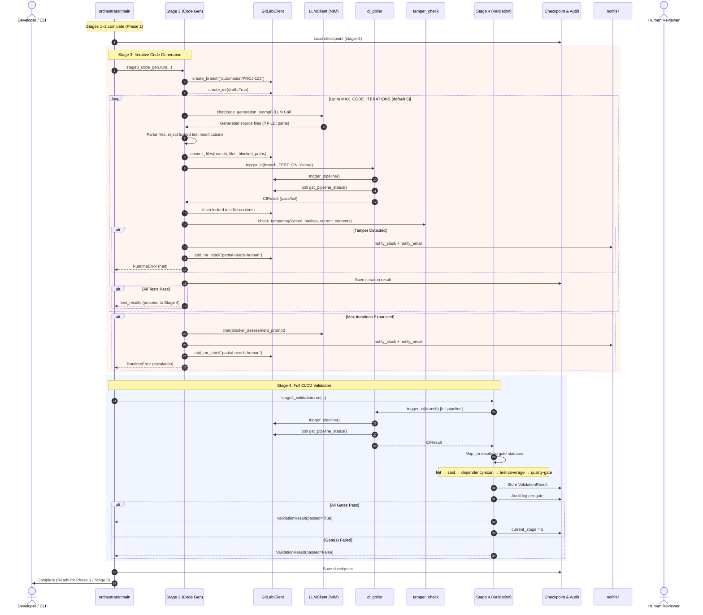

# Phase 2 Implementation Guide: Iterative Code Generation & CI Validation

This document provides an exhaustive, serialized breakdown of **Phase 2** of the Spec-Driven Development Automation pipeline. Phase 2 adds Stage 3 (iterative code generation with tamper-checking) and Stage 4 (full CI/CD validation gates) to the pipeline established in Phase 1.

---

## 1. High-Level Architecture Overview

Phase 2 extends the pipeline with two new stages:
- **Stage 3 — Iterative Code Generation**: Prompts the LLM to generate source code changes, runs them against the locked test suite via CI, tamper-checks the locked tests after every iteration, and either succeeds or escalates.
- **Stage 4 — CI/CD Validation**: Triggers the full CI pipeline (ESLint, Semgrep, Trivy, Jest coverage, SonarQube) and evaluates all gate results.



---

## 2. Serialized End-to-End Flow (Step-by-Step)

### Prerequisites (Phase 1 Complete)

Before Stage 3 begins, the following must be true:
- `checkpoint.current_stage >= 3`
- `checkpoint.locked_test_hashes` contains SHA-256 digests of all approved test files
- `checkpoint.gate1_approved == True`
- The tests-only MR has been approved and locked test files are committed to the repo

---

### Stage 3: Iterative Code Generation

#### Step 3.0: Branch & MR Setup

1. **Branch creation**: Creates `automation/<TICKET_ID>` from the default branch (if it doesn't exist).
2. **Draft MR**: Opens a draft MR titled `[Automated] <TICKET_ID>: <SUMMARY>` from the code branch to the default branch.
3. **Locked paths collection**: Extracts the set of locked test file paths from `checkpoint.locked_test_hashes`.

#### Step 3.1–3.N: Coding Loop (up to 6 iterations)

Each iteration follows this sequence:

1. **LLM Prompting** (`_generate_code`):
   - Builds a comprehensive prompt containing: ticket spec, acceptance criteria, current source file contents, locked test file contents (read-only), and the previous iteration's full Jest output.
   - Sends to the LLM via `llm.chat()`.
   - Parses the response using `_parse_generated_files()` — same `// FILE:` format as Stage 2.

2. **Locked File Rejection**:
   - If the LLM's response includes any file path matching a locked test path, those files are removed from the result.
   - The LLM is re-prompted (up to 3 sub-attempts) telling it the files are immutable.
   - This is a **soft enforcement** layer; hard enforcement happens at commit time.

3. **Commit to Branch**:
   - `gitlab_client.commit_files()` with `blocked_paths=locked_paths` — if any locked file somehow makes it past the soft check, the commit is rejected with a `ValueError`.
   - Each iteration produces exactly one commit for clean MR history.

4. **Trigger Test-Only CI**:
   - `ci_poller.trigger_ci(branch, variables={"TEST_ONLY": "true"})` triggers a pipeline where only the `test` stage runs (lint/sast/coverage/quality-gate are skipped).
   - `ci_poller.wait_for_pipeline()` polls until the pipeline reaches a terminal state.

5. **Tamper-Check**:
   - Fetches the current content of all locked test files from the branch via GitLab API.
   - Calls `tamper_check.check_tampering()` to compare SHA-256 hashes.
   - If tampering is detected: **halt immediately** → audit log → JIRA comment → Slack/email → label MR `partial-needs-human` → raise `RuntimeError`.

6. **Record Iteration**:
   - Test results and iteration metadata are stored in the checkpoint.
   - Checkpoint is persisted to disk for crash recovery.

7. **Success/Continue Decision**:
   - If all target tests pass (`ci_result.passed` and `test_results.failed == 0`): exit loop, set `checkpoint.current_stage = 4`, return results.
   - Otherwise: the Jest output is fed back into the next iteration's LLM prompt.

#### Step 3.E: Escalation Path (Max Iterations Exhausted)

If the loop reaches iteration 6 without all tests passing:

1. Ask the LLM for a blocker assessment (brief summary of why tests are still failing).
2. Build an escalation message via `notifier.build_escalation_message()`.
3. Label the MR `partial-needs-human` via `gitlab.add_mr_label()`.
4. Post the escalation summary as a JIRA comment via `jira.post_comment()`.
5. Send Slack notification via `notifier.notify_slack()`.
6. Send email notification via `notifier.notify_email()`.
7. Raise `RuntimeError` to halt the pipeline. The checkpoint is saved by `main.py`'s exception handler.

---

### Stage 4: Full CI/CD Validation

After Stage 3 succeeds, Stage 4 runs the full CI pipeline:

#### Step 4.1: Trigger Full Pipeline

- `ci_poller.trigger_ci(code_branch)` — no `TEST_ONLY` variable, so all CI stages run.
- Pipeline ID stored in `checkpoint.ci_pipeline_id`.

#### Step 4.2: Wait for Completion

- `ci_poller.wait_for_pipeline()` polls until a terminal state (`success`, `failed`, `canceled`).

#### Step 4.3: Map Gate Results

The CI pipeline is expected to have these jobs (defined in `ci_templates/gitlab-ci-template.yml`):

| Gate Name | CI Job | Tool | Pass Criteria | Required? |
|---|---|---|---|---|
| `lint` | `lint` | ESLint | 0 errors | Yes |
| `sast` | `sast` | Semgrep | 0 high/critical findings | Yes |
| `dependency-scan` | `dependency-scan` | Trivy | 0 critical CVEs | Yes |
| `test-coverage` | `test-coverage` | Jest `--coverage` | Line coverage ≥ threshold | Yes |
| `quality-gate` | `quality-gate` | SonarQube | Quality Gate: Passed | Only if configured |

- SonarQube is optional: if `SONAR_HOST_URL` is empty, the `quality-gate` job is treated as non-required and its status is set to `skipped`.
- Each gate result is individually logged to the audit trail.

#### Step 4.4: Overall Determination

- If all **required** gates pass: `ValidationResult.overall_status = "passed"`, `checkpoint.current_stage = 5`.
- If any required gate fails: `ValidationResult.overall_status = "failed"`, stage does **not** advance.

---

## 3. Detailed File-by-File Breakdown

### 3.1 `orchestrator/ci_poller.py`
- **Role**: CI/CD pipeline triggering and status polling.
- **Responsibilities**:
  - `trigger_ci()`: Delegates to `GitLabClient.trigger_pipeline()`, returns pipeline ID.
  - `wait_for_pipeline()`: Polls `GitLabClient.get_pipeline_status()` at configurable intervals until the pipeline reaches a terminal state (`success`, `failed`, `canceled`).
  - Raises `CITimeoutError` if the pipeline doesn't complete within `CI_TIMEOUT_MINUTES`.
  - Returns `CIResult` dataclass with pipeline status, URL, and per-job breakdown.
  - `CIResult.job_status(name)`: Helper to look up a specific job's status.

### 3.2 `orchestrator/stages/stage3_code_gen.py`
- **Role**: Stage 3 orchestrator logic — iterative code generation with tamper-checking.
- **Responsibilities**:
  - Main `run()` function executing the coding loop (up to `MAX_CODE_ITERATIONS`).
  - `_generate_code()`: Builds the LLM prompt with ticket context, source files, locked tests, and previous Jest output. Handles locked file rejection with up to 3 sub-attempts.
  - `_parse_generated_files()`: Parses `// FILE:` format responses (same pattern as Stage 2).
  - `_fetch_locked_test_contents()`: Fetches current locked test file contents from GitLab for tamper-checking.
  - `_parse_ci_test_results()`: Derives pass/fail from CI pipeline job statuses.
  - `_format_test_output()`: Formats human-readable test output for LLM feedback and escalation.
  - `_get_blocker_assessment()`: Asks the LLM for a brief assessment of why tests are still failing.
  - `_handle_escalation()`: Executes the full escalation path (label MR, JIRA comment, Slack, email).
  - Implements FR-9 (iterative code gen), FR-10 (no test modification), FR-11 (tamper-check).

### 3.3 `orchestrator/stages/stage4_validation.py`
- **Role**: Stage 4 orchestrator logic — full CI/CD validation gates.
- **Responsibilities**:
  - Main `run()` function triggering the full CI pipeline and evaluating results.
  - `_map_gate_statuses()`: Maps CI job results to structured `GateStatus` objects.
  - `GateStatus` dataclass: Per-gate result with `name`, `status`, `required`, and `passed` property.
  - `ValidationResult` dataclass: Aggregated result with `overall_status`, `gates`, `passed` property, and `to_dict()` for checkpoint serialization.
  - Handles SonarQube optionality: if not configured, the `quality-gate` is marked as non-required and skipped.
  - Logs each gate result individually to the audit trail.
  - Implements FR-12 through FR-16.

### 3.4 `ci_templates/gitlab-ci-template.yml`
- **Role**: Reusable GitLab CI pipeline template for target JavaScript/TypeScript repos.
- **Responsibilities**:
  - Defines 6 CI stages: `test`, `lint`, `sast`, `dependency-scan`, `test-coverage`, `quality-gate`.
  - Supports `TEST_ONLY` mode: when `TEST_ONLY=true`, only the `test` stage runs (used by Stage 3).
  - `test`: Runs Jest with optional `TEST_PATTERN` variable, outputs JSON results artifact.
  - `lint`: Runs ESLint, outputs JSON report, fails on any error-level findings.
  - `sast`: Runs Semgrep with auto config, outputs JSON report.
  - `dependency-scan`: Runs Trivy filesystem scan, fails on critical CVEs.
  - `test-coverage`: Runs Jest with LCOV coverage output.
  - `quality-gate`: Runs SonarQube scanner (skipped if `SONAR_HOST_URL` is empty), polls for quality gate status.

---

## 4. LLM Prompts & Interaction Points in Phase 2

| Call Point | Module & Function | Purpose | Prompt Strategy | Fallback Handling |
|---|---|---|---|---|
| **LLM Call #N** (per iteration) | `stage3_code_gen.py` → `_generate_code` | Generate source code changes to make locked tests pass | Provides ticket spec, current source files, locked test files (read-only), and previous Jest output. Instructs model to generate only source files using `// FILE:` format. | Retries up to 3 times per model; switches to DeepSeek V4 Pro after 3 consecutive primary failures. |
| **LLM Call #N+1** (conditional, per iteration) | `stage3_code_gen.py` → `_generate_code` | Re-prompt after locked file rejection | Tells the model which files are immutable and asks for a new attempt without modifying them. | Up to 3 sub-attempts within a single iteration. |
| **LLM Call (escalation)** | `stage3_code_gen.py` → `_get_blocker_assessment` | Summarise why tests are still failing | Provides the last Jest output and asks for a 2-3 sentence assessment. | Single attempt; falls back to "Unable to determine blocker." |

---

## 5. Modified Files from Phase 1

### 5.1 `orchestrator/config.py`
- Added `ci_poll_interval_seconds` (default 30) — polling interval for CI pipeline status.
- Added `ci_timeout_minutes` (default 30) — max time to wait for a CI pipeline run.

### 5.2 `orchestrator/checkpoint.py`
- Added `ci_pipeline_id: int | None` — tracks the active CI pipeline for checkpoint recovery.
- Added `validation_result: dict[str, Any]` — stores Stage 4 results for Stage 5 consumption.

### 5.3 `orchestrator/main.py`
- Updated docstring and CLI description to reflect Phase 1–2 scope.
- Added imports for `stage3_code_gen` and `stage4_validation`.
- Replaced the "Stages 3–5 not yet implemented" placeholder with actual Stage 3 → Stage 4 execution.
- Stage 5 placeholder now reads "Stage 5 (PR promotion + Gate 2) is not yet implemented (Phase 3)."

### 5.4 `.env.example`
- Added `CI_POLL_INTERVAL_SECONDS` and `CI_TIMEOUT_MINUTES` environment variables.
- Renamed SonarQube section header (removed "Phase 2+" qualifier).

---

## 6. Directory & Artifact Structure (Post-Phase 2)

```
SpecDrivenDevAutomation/
├── .env.example
├── .gitignore
├── requirements.txt
├── docs/
│   ├── SpecDrivenDevelopment_PRD.md
│   ├── implementation_plan.md
│   ├── Phase1ImplementationGuide.md
│   └── Phase2ImplementationGuide.md    ← This guide
├── ci_templates/
│   └── gitlab-ci-template.yml          ← [NEW] CI pipeline template
├── docker/
│   ├── Dockerfile
│   └── docker-compose.yml
├── orchestrator/
│   ├── __init__.py
│   ├── main.py                         ← [MODIFIED] Stages 3-4 wired
│   ├── config.py                       ← [MODIFIED] CI polling settings
│   ├── rate_limiter.py
│   ├── llm_client.py
│   ├── jira_client.py
│   ├── gitlab_client.py
│   ├── gitlab_gate.py
│   ├── tamper_check.py
│   ├── checkpoint.py                   ← [MODIFIED] CI/validation fields
│   ├── audit.py
│   ├── notifier.py
│   ├── ci_poller.py                    ← [NEW] CI trigger & polling
│   └── stages/
│       ├── __init__.py
│       ├── stage1_context.py
│       ├── stage2_test_gen.py
│       ├── stage3_code_gen.py          ← [NEW] Iterative code gen
│       └── stage4_validation.py        ← [NEW] Full CI validation
├── tests/
│   ├── __init__.py
│   └── unit/
│       ├── test_audit.py
│       ├── test_checkpoint.py
│       ├── test_config.py              ← [MODIFIED] .env fix
│       ├── test_rate_limiter.py
│       ├── test_tamper_check.py
│       ├── test_gitlab_gate.py
│       ├── test_ci_poller.py           ← [NEW] 9 tests
│       ├── test_stage3_code_gen.py     ← [NEW] 14 tests
│       └── test_stage4_validation.py   ← [NEW] 10 tests
├── checkpoints/
└── audit/
```
