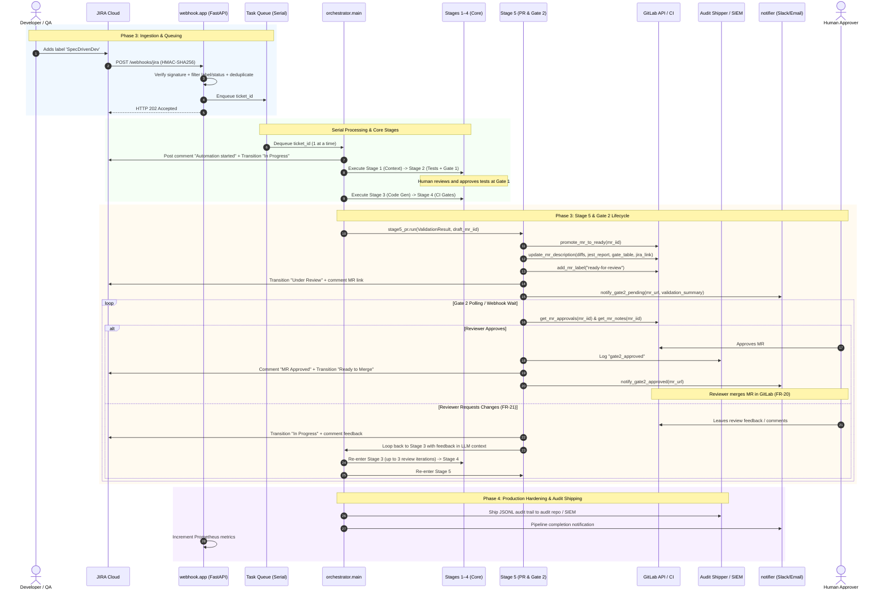

# Phase 3 & Phase 4 Detailed Implementation Plan

This document provides the comprehensive, serialized technical design and implementation guide for **Phase 3 (Full Event-Driven Automation & MR Lifecycle)** and **Phase 4 (Pilot Rollout & Production Hardening)** of the Spec-Driven Development Automation Pipeline.

---

## 1. Context & Prerequisites

### Completed Milestones
- **Phase 1**: Orchestrator core, checkpointing, token-bucket rate limiter (≤32 calls/min), tamper-checking, JIRA context assembly (Stage 1), and test generation with human Gate 1 approval (Stage 2).
- **Phase 2**: Iterative code generation with locked test diff enforcement (Stage 3), CI/CD validation gates across ESLint, Semgrep, Trivy, Jest coverage, and SonarQube (Stage 4), and reusable `ci_templates/gitlab-ci-template.yml`.
- **Test Suite**: 71/71 unit tests passing across all components with 0 regressions.

### Target Scope for Phase 3 & Phase 4
- **Phase 3**:
  1. Automated webhook ingestion service (`webhook/app.py` via FastAPI).
  2. HMAC-SHA256 signature verification, event filtering, deduplication, and serial queuing.
  3. Stage 5 implementation (`orchestrator/stages/stage5_pr.py`): MR promotion, rich description generation, and human Gate 2 approval wait.
  4. Human reviewer feedback routing (FR-21): capturing review comments on MR, appending to LLM conversation context, and re-entering Stage 3.
  5. Bidirectional JIRA synchronization and lifecycle status advancement.
  6. Escalation and notification integration.
- **Phase 4**:
  1. Container infrastructure hardening (`docker/Dockerfile` & `docker/docker-compose.yml`) with non-root security.
  2. Audit log governance & immutable SIEM/Git-backed shipping (`orchestrator/audit_shipper.py`).
  3. Target repository onboarding guidelines and sandboxing rules (`docs/RepositoryOnboardingGuide.md`).
  4. Ticket qualification heuristics and automated triage in Stage 1.
  5. 4-week structured pilot rollout plan and operational runbooks (`docs/PilotRolloutRunbook.md`).

---

## 2. End-to-End Architecture Flow



---

## 3. Detailed Component Design: Phase 3

### 3.1 Webhook Ingestion Service (`webhook/app.py`)

#### Responsibilities
- Receives inbound HTTP POST notifications from JIRA Cloud webhooks.
- Authenticates incoming requests via HMAC-SHA256.
- Enforces qualification filters (Project Key, `SpecDrivenDev` label, transition status).
- Deduplicates retransmitted webhooks within a 10-minute sliding window.
- Immediately acknowledges receipt (`HTTP 202 Accepted`) to prevent JIRA webhook timeouts.
- Enqueues jobs into a FIFO in-process `asyncio.Queue`.
- Runs a persistent background queue worker that processes tickets serially to respect free-tier rate limits (FR-27 & FR-28).

#### API Endpoints
1. **`POST /webhooks/jira`**:
   - Headers: `X-Hub-Signature` (format: `sha256=<hex_digest>`).
   - Query parameter fallback: `?secret=<token>`.
   - Security verification:
     ```python
     expected_signature = hmac.new(
         webhook_secret.encode(), raw_body, hashlib.sha256
     ).hexdigest()
     if not hmac.compare_digest(f"sha256={expected_signature}", signature_header):
         raise HTTPException(status_code=401, detail="Invalid HMAC signature")
     ```
   - Filtering criteria:
     - `webhookEvent in ["jira:issue_created", "jira:issue_updated"]`
     - `issue.fields.project.key == settings.jira_project_key`
     - `settings.qualifying_label in issue.fields.labels`
     - `issue.fields.status.name in ["Ready for Automation", "To Do"]`
   - Deduplication check:
     - `cache_key = f"{issue_key}:{event_timestamp}"`
     - If key exists in cache, log warning and return `{"status": "duplicate_ignored"}`.
   - Enqueuing:
     - `await task_queue.put(issue_key)`
     - Return `{"status": "queued", "ticket_id": issue_key, "queue_position": task_queue.qsize()}`.

2. **`POST /webhooks/gitlab`** *(Optional acceleration)*:
   - Authenticated via `X-Gitlab-Token`.
   - Wakes up active Gate 1 or Gate 2 polling loops when an MR approval event occurs, avoiding polling latency.

3. **`GET /health`**:
   - Reports liveness/readiness: `{"status": "ok", "worker": "idle"|"busy", "active_ticket": "...", "queue_length": 0}`.

4. **`GET /metrics`**:
   - Prometheus metrics endpoint reporting ticket counters, stage latency, and rate limiter pauses.

---

### 3.2 Stage 5 — PR Promotion & Gate 2 (`orchestrator/stages/stage5_pr.py`)

#### Responsibilities
1. **MR Promotion**: Calls `gitlab.promote_mr_to_ready(draft_mr_iid)` to strip the `"Draft: "` prefix.
2. **Rich Description Assembly**: Formats markdown with:
   - Originating JIRA Ticket link: `**Originating JIRA Ticket:** [PROJ-123](url) — *Closes PROJ-123*`.
   - Automated Code Changes Summary: list of modified/created files and change summary.
   - Target Test Execution Report: pass/fail counts, duration, Jest output.
   - Consolidated CI/CD Quality Gate Status Table:
     | Gate | Tool | Status | Details |
     |---|---|---|---|
     | Linting | ESLint | PASS | 0 errors |
     | SAST | Semgrep | PASS | 0 high/critical findings |
     | Dependency Scan | Trivy | PASS | 0 critical CVEs |
     | Code Coverage | Jest | PASS | 84.5% (Threshold: ≥80%) |
     | Consolidated Gate | SonarQube | PASS | Quality Gate: Passed |
   - Governance Statement: Confirmation that tests were locked at Gate 1 and tamper-checked.
3. **Labels & Metadata**: Adds labels `ready-for-review`, `spec-driven-dev`.
4. **JIRA Synchronization**:
   - Transitions JIRA ticket to `"Under Review"`.
   - Posts comment containing MR link and gate summary table.
5. **Reviewer Notification**:
   - Calls `notifier.notify_gate2_pending(...)` for Slack and Email alerts.
6. **Gate 2 Human Approval Monitoring**:
   - Polls `gitlab_gate.wait_for_approval(mr_iid, ...)`:
     - If approved:
       - Logs `gate2_approved` to audit log.
       - Posts comment to JIRA: `✅ GitLab MR !{mr_iid} approved by @{user}. Ready for human merge.`
       - Transitions JIRA to `"Approved"` / `"Ready to Merge"`.
       - Sends approval notification.
       - Returns `Stage5Result(status="approved", ...)`.
       - **Human Merge Rule (FR-20)**: The automated pipeline never merges code. The reviewer performs the squash-merge in GitLab.
     - If reviewer requests changes (FR-21):
       - Extracts review comments via `gitlab.get_mr_notes(mr_iid)`.
       - Logs `reviewer_changes_requested` in audit.
       - Posts comment on JIRA: `🔄 Reviewer requested changes on MR !{mr_iid}. Re-entering coding loop.`
       - Transitions JIRA back to `"In Progress"`.
       - Returns `Stage5Result(status="changes_requested", reviewer_feedback=comments)`.

---

### 3.3 Reviewer Feedback Loop Integration (`orchestrator/main.py`)

When Stage 5 detects changes requested:
```python
if stage5_result.status == "changes_requested":
    if checkpoint.review_iteration_count >= settings.max_review_iterations:
        logger.warning("Max review iterations (%d) reached. Escalating to human.",
                       settings.max_review_iterations)
        notifier.notify_slack(settings.slack_webhook_url, "Max review iterations exhausted")
        return 1

    checkpoint.review_iteration_count += 1
    feedback_prompt = (
        f"Reviewer feedback on MR !{checkpoint.draft_mr_iid}:\n"
        f"{stage5_result.reviewer_feedback}\n\n"
        "Please modify the source code to address the reviewer feedback. "
        "Do not modify any locked test files."
    )
    llm.append_user_message(feedback_prompt)
    checkpoint.current_stage = 3
    checkpoint.save(settings.checkpoint_dir)
    # Loop resumes at Stage 3 -> Stage 4 -> Stage 5
```

---

### 3.4 JIRA Client Enhancements (`orchestrator/jira_client.py`)

- **Dynamic Transition Resolution**:
  ```python
  def find_transition(self, ticket_id: str, candidate_names: list[str]) -> str | None:
      """Dynamically match transition ID by comparing against valid issue transitions."""
      transitions = self._jira.get_issue_transitions(ticket_id)
      for candidate in candidate_names:
          for t in transitions:
              if t["name"].strip().lower() == candidate.strip().lower():
                  return t["id"]
      return None
  ```
- **Standardized Comments**: Helper functions for `post_start_comment`, `post_gate1_comment`, `post_gate2_comment`, `post_feedback_comment`, and `post_completion_comment`.

---

## 4. Detailed Component Design: Phase 4

### 4.1 Production Container Hardening

#### `docker/Dockerfile`
```dockerfile
FROM python:3.12-slim AS runtime

# Create unprivileged user
RUN groupadd -g 10001 appgroup && \
    useradd -u 10001 -g appgroup -s /bin/bash -m appuser

WORKDIR /app

COPY requirements.txt .
RUN pip install --no-cache-dir -r requirements.txt

COPY orchestrator/ ./orchestrator/
COPY webhook/ ./webhook/
COPY ci_templates/ ./ci_templates/

# Ensure directories for checkpoints and audit exist with proper ownership
RUN mkdir -p /app/checkpoints /app/audit && \
    chown -R appuser:appgroup /app

USER appuser
ENV PYTHONPATH=/app \
    PYTHONUNBUFFERED=1

EXPOSE 8000

HEALTHCHECK --interval=30s --timeout=5s --start-period=10s --retries=3 \
    CMD curl -f http://localhost:8000/health || exit 1

CMD ["python", "-m", "orchestrator.main", "--server"]
```

#### `docker/docker-compose.yml`
```yaml
version: "3.8"

services:
  orchestrator:
    build:
      context: ..
      dockerfile: docker/Dockerfile
    container_name: spec-driven-orchestrator
    restart: unless-stopped
    ports:
      - "8000:8000"
    env_file:
      - ../.env
    volumes:
      - checkpoints_data:/app/checkpoints
      - audit_data:/app/audit
    deploy:
      resources:
        limits:
          cpus: "2.0"
          memory: 2048M
    security_opt:
      - no-new-privileges:true
    read_only: false

volumes:
  checkpoints_data:
  audit_data:
```

---

### 4.2 Audit Log Governance & SIEM Shipping (`orchestrator/audit_shipper.py`)

Provides immutable, tamper-evident audit trail management (FR-25):
- **Git-Backed Mode (`git`)**:
  - Collects completed ticket audit files: `audit/{ticket_id}.jsonl`.
  - Calculates SHA-256 integrity hash:
    ```python
    sha256 = hashlib.sha256(content.encode("utf-8")).hexdigest()
    ```
  - Commits file to a dedicated, write-restricted GitLab repository (`spec-driven-audit-trail`) under `logs/{YEAR}/{MONTH}/{ticket_id}.jsonl`.
- **SIEM Mode (`http`)**:
  - Streams JSONL entries via HTTPS POST with bearer auth to enterprise SIEM (Splunk HEC, Elasticsearch, Datadog).
  - Handles retries with exponential backoff and local spooling.

---

### 4.3 Target Repository Onboarding Standard (`docs/RepositoryOnboardingGuide.md`)

Step-by-step onboarding protocol:
1. **Repository Qualification**:
   - Modern JavaScript / TypeScript project (React/Redux, Node.js).
   - Pre-existing Jest test suite and ESLint configuration.
2. **CI Template Inclusion**:
   - Reference `ci_templates/gitlab-ci-template.yml` in `.gitlab-ci.yml`.
3. **Service Account Permissions**:
   - Account: `spec-driven-bot`.
   - Role: `Developer` (restricted from pushing to protected branches).
4. **Branch Protection**:
   - Default branch (`main`): Protected, push disabled, merge requires human approval.

---

### 4.4 Ticket Qualification Gating & Triage (`orchestrator/stages/stage1_context.py`)

Heuristic filter executing before any LLM inference or branch creation:
- **Eligible**: Standard bug fixes, small feature improvements, test additions.
- **Ineligible**: Database schema migrations, authentication/crypto changes, multi-repository modifications.
- **Automated Triage Feedback**:
  - If a ticket is ineligible, bot adds a comment on JIRA explaining why, removes `SpecDrivenDev` label, and exits cleanly.

---

### 4.5 Observability, Alerting & 4-Week Pilot Rollout Runbook (`docs/PilotRolloutRunbook.md`)

#### Prometheus Metrics
- `spec_dev_tickets_queued_total`
- `spec_dev_tickets_completed_total{status="success|escalated|rejected"}`
- `spec_dev_stage_duration_seconds{stage="1|2|3|4|5"}`
- `spec_dev_nim_calls_total`
- `spec_dev_nim_rate_limit_pauses_total`
- `spec_dev_tamper_events_total`

#### 4-Week Rollout Milestones
- **Week 1: Synthetic Sandbox Pilot**: Deploy stack to staging, run 5 synthetic tickets against sandbox repo, test all error paths.
- **Week 2: Shadow Mode on Pilot Repo**: Onboard 1 production repo, run on 5 historical bugs with 100% human review.
- **Week 3: Active Pilot with Human-on-the-Loop**: Enable for 10–15 real tickets with developers reviewing Gate 1 & Gate 2.
- **Week 4: Success Metric Evaluation**: Evaluate against PRD Section 8 targets (≥70% success rate, <45 min turnaround, 0% regressions, 100% tamper detection).

---

## 5. Verification Plan

### Automated Unit Tests
```bash
# Existing Phase 1 & 2 tests (regression check)
python -m pytest tests/unit/ -v

# New Phase 3 tests
python -m pytest tests/unit/test_webhook.py tests/unit/test_stage5_pr.py tests/unit/test_jira_client.py -v

# New Phase 4 tests
python -m pytest tests/unit/test_audit_shipper.py -v

# Full suite verification
python -m pytest tests/unit/ -v
```

### Manual Verification Checklist
1. **Webhook Ingestion & HMAC**: Test valid signature, invalid signature (401), non-qualifying labels, duplicate events.
2. **Stage 5 PR Promotion**: Verify Draft prefix stripped, description populated with CI gate table, JIRA updated, Slack/Email sent.
3. **Gate 2 Approval**: Reviewer approves in GitLab → verify `gate2_approved` logged, JIRA transitioned to "Ready to Merge", human merges.
4. **Reviewer Feedback Loop (FR-21)**: Submit review comment → verify pipeline detects comment, re-enters Stage 3, and updates MR.
5. **Audit Log Shipping**: Verify JSONL audit file is hashed and committed to audit repo.
6. **Container Health & Metrics**: Test `GET /health` and `GET /metrics`.
