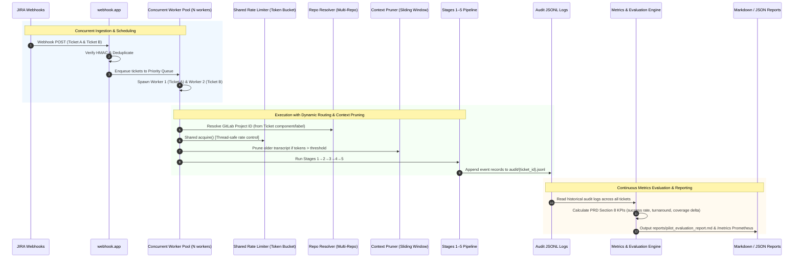

# Phase 5 Implementation Plan: Evaluation, Scaling, Concurrency & Tier Adaptation

This document details the architecture and implementation design for **Phase 5** of the Spec-Driven Development Automation Pipeline, addressing PRD Milestone 5: **Evaluate metrics, expand scope, and scale infrastructure**.

---

## 1. Overview & Goals

Phases 1 through 4 established an end-to-end event-driven pipeline from JIRA ticket trigger to human-approved GitLab Merge Request, validated with 103 unit tests.

Phase 5 scales this architecture into a production-grade enterprise system by adding:
1. **Metrics & Evaluation Engine (`orchestrator/metrics_engine.py`)**: Computes PRD Section 8 success metrics from historical audit logs and produces automated Markdown/JSON evaluation reports.
2. **Concurrent Worker Pool (`orchestrator/concurrency.py`)**: Enables parallel processing of multiple tickets (`MAX_CONCURRENT_TICKETS = N`) with shared rate limit budgeting.
3. **Context Window Pruner (`orchestrator/context_pruner.py`)**: Condenses long-running multi-iteration transcripts to prevent LLM context limit overflows.
4. **Dynamic Multi-Repository Resolver (`orchestrator/repo_resolver.py`)**: Dynamically routes tickets to specific GitLab repositories based on JIRA components or labels.

---

## 2. Architecture & Data Flow

---

## 3. Module Specifications

### 3.1 Metrics & Evaluation Engine (`orchestrator/metrics_engine.py`)
- Reads historical audit logs from `audit/*.jsonl`.
- Aggregates telemetry across all completed tickets.
- Evaluates PRD Section 8 KPIs:
  - **Auto-resolution Rate**: `(successful_prs / eligible_tickets) * 100` (Target: ≥70%)
  - **Turnaround Time**: Average and median duration from pipeline start to Gate 2 approval.
  - **First-Pass Approval Rate**: `% of PRs approved without reviewer change requests`.
  - **Iteration Statistics**: Mean and distribution of coding iterations (1–6) and review cycles (0–3).
  - **Rate Limit Compliance**: Mean LLM calls consumed and pause duration per ticket.
  - **Tamper Detection Rate**: 100% detection rate verification.
- Outputs:
  - Formatted Markdown report (`reports/pilot_evaluation_report.md`).
  - Structured JSON summary (`reports/metrics_summary.json`).
  - CLI runner: `python -m orchestrator.metrics_engine`.

### 3.2 Concurrent Worker Pool (`orchestrator/concurrency.py`)
- Replaces the single-ticket serial loop with `ConcurrentWorkerPool`.
- Configurable worker count: `MAX_CONCURRENT_TICKETS = 2` (default for free tier; scales up on paid tier).
- Thread-safe shared rate limiter integration ensuring total system calls across all parallel workers never exceed `rate_limit_cap` (32 calls/min).
- Graceful worker shutdown and per-worker telemetry.

### 3.3 Context Window Pruner (`orchestrator/context_pruner.py`)
- Analyzes conversation history token count before each LLM call.
- If prompt exceeds `MAX_CONTEXT_TOKENS` (default: 16,000):
  - Preserves system prompt and initial ticket specification.
  - Condenses iterations N-2 and earlier into concise summary checkpoints.
  - Retains the most recent 2 iterations (source diffs, latest Jest output, reviewer comments) in full.

### 3.4 Dynamic Repository Resolver (`orchestrator/repo_resolver.py`)
- Resolves target GitLab project ID from:
  1. JIRA component (e.g. `Component: "UI"` -> `12345`)
  2. JIRA label (e.g. `Label: "repo-backend"` -> `67890`)
  3. Default fallback (`settings.gitlab_repo_id`)
- Configured via JSON string `REPO_MAPPING={"frontend": 101, "backend": 102}` in `.env`.

---

## 4. Phase 5 Implementation Checklist

- [ ] `orchestrator/config.py` — add Phase 5 configuration settings
- [ ] `orchestrator/metrics_engine.py` — implement KPI aggregation and Markdown/JSON report generator
- [ ] `orchestrator/concurrency.py` — implement concurrent worker pool with shared rate limiting
- [ ] `orchestrator/context_pruner.py` — implement transcript sliding window pruning
- [ ] `orchestrator/repo_resolver.py` — implement dynamic multi-repository resolution
- [ ] `orchestrator/llm_client.py` — integrate context pruner hook
- [ ] `orchestrator/stages/stage1_context.py` — integrate repo resolver
- [ ] `webhook/app.py` — upgrade serial worker to `ConcurrentWorkerPool`
- [ ] `docs/Phase5ImplementationGuide.md` — comprehensive architectural guide
- [ ] Unit Tests:
  - `tests/unit/test_metrics_engine.py`
  - `tests/unit/test_concurrency.py`
  - `tests/unit/test_context_pruner.py`
  - `tests/unit/test_repo_resolver.py`
- [ ] Verify full test suite (100% pass rate)
